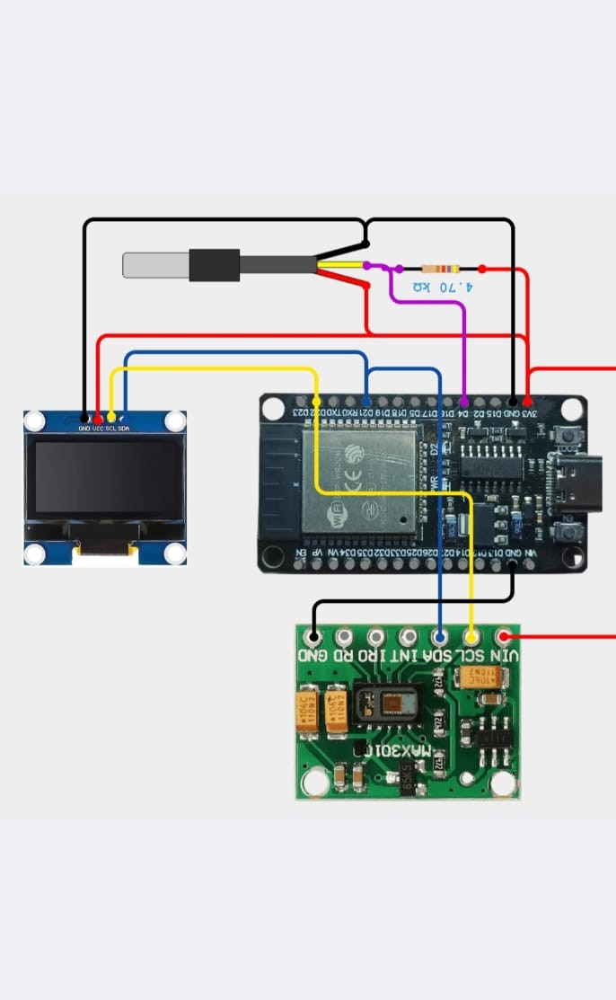
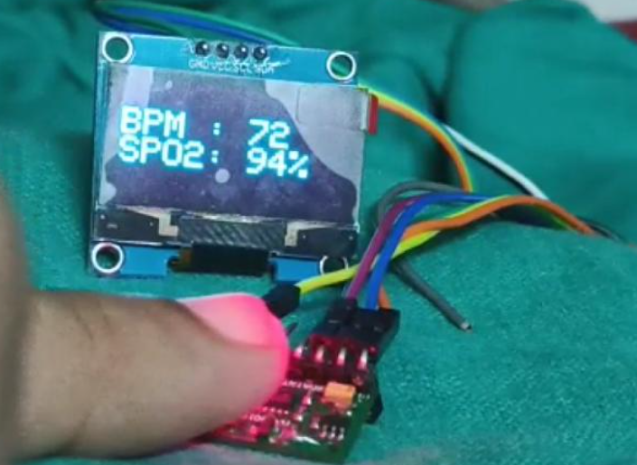

# Health Monitoring Wrist Band

An IoT-based health monitoring project using ESP32 and sensors to monitor basic health parameters.

## Project Overview

The Health Monitoring Wrist Band is designed to collect health-related information using different sensors connected to an ESP32 microcontroller. The collected readings are processed and displayed through an OLED display and Serial Monitor.

## Project Objectives

- Monitor heart rate using a pulse sensor.
- Measure temperature using a temperature sensor.
- Detect possible falls using an MPU6050 sensor.
- Display sensor readings in real time.

## Hardware Components

- ESP32 Development Board
- Pulse Sensor
- DS18B20 Temperature Sensor
- MPU6050 Accelerometer and Gyroscope
- OLED Display
- Breadboard
- Jumper Wires
- Power Supply

## Software Requirements

- Arduino IDE
- ESP32 Board Package
- Embedded C/C++
- Required sensor libraries

## Project Features

1. Heart rate monitoring.
2. Temperature measurement.
3. Fall detection.
4. OLED display output.
5. Serial Monitor output.

## Circuit Diagram

## Project Images

### Project Kit

### Kit Explanation

### Health Monitoring Wrist Band

## Working Principle

The sensors collect health-related data and send it to the ESP32 microcontroller. The ESP32 processes the sensor readings and displays the results on the OLED display and Serial Monitor.

## Applications

- Basic health monitoring
- Personal fitness monitoring
- IoT-based healthcare projects
- Educational and research purposes

## Author

**Arani Yogeswari**

Department of Artificial Intelligence and Data Science

## Project Repository

[Health Monitoring Wrist Band – GitHub](https://github.com/araniyogeswari/Health_Monitoring_Wrist_Band)